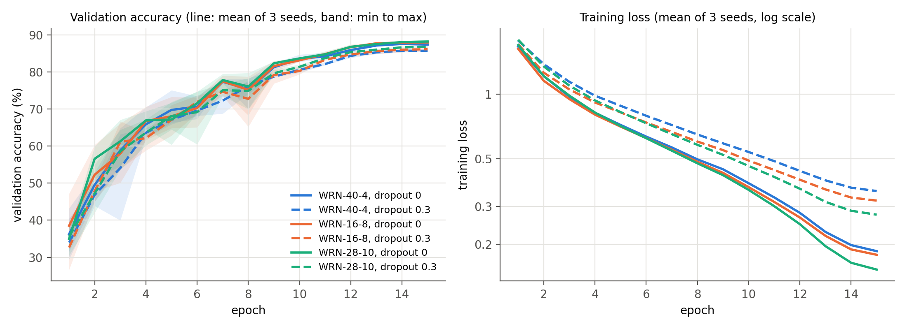
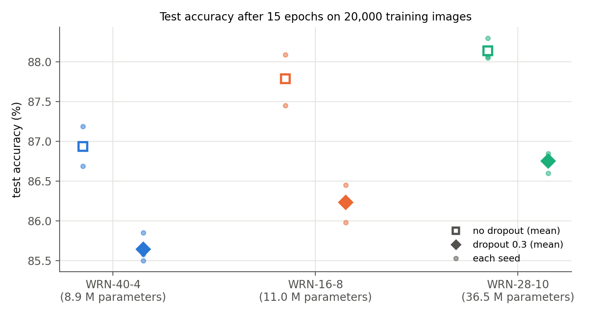
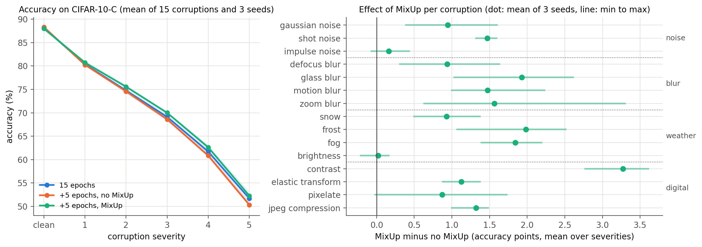
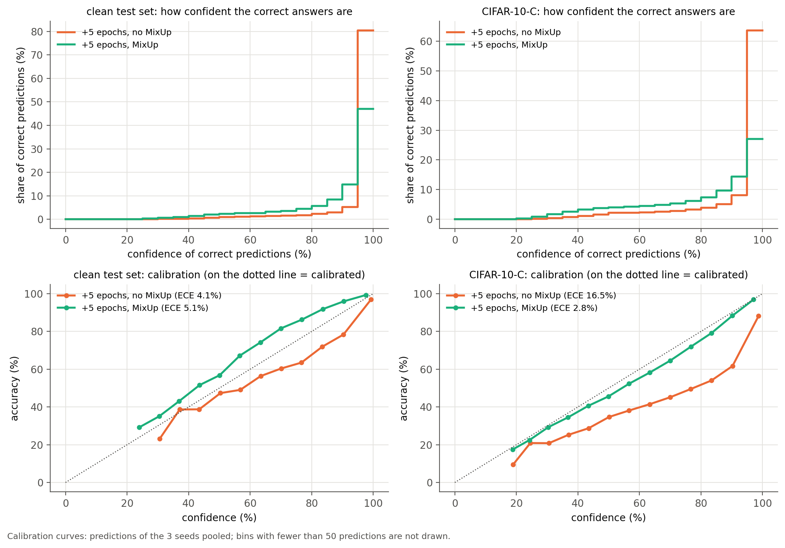

# Wide ResNets on CIFAR-10: Width, Dropout, MixUp and Robustness to Corruptions


Lab 1 of a university course on neural networks and deep learning (coursework, 2024-2025). It trains Wide Residual Networks on CIFAR-10 image classification and asks four questions:

- Is a wide, shallow network better than a thin, deep one?
- Does dropout help?
- Does MixUp make a model more robust to corrupted images (CIFAR-10-C)?
- How confident and how well calibrated are the models?

Every configuration runs with 3 random seeds. The model is chosen on a validation set, and the test set is used only for the final numbers. The whole notebook runs in about 2 hours on a free Kaggle session with two T4 GPUs.

## Results at a glance

| Question | Result |
|---|---|
| Width against depth | WRN-16-8 (16 layers, 11.0M parameters) beats the deeper WRN-40-4 (40 layers, 8.9M): **87.8 %** vs 86.9 % test accuracy, and trains slightly faster |
| Best model after 15 epochs on 20,000 images | **88.1 %** test accuracy (WRN-28-10, 36.5M parameters), at 3.5 times the training time of WRN-16-8 |
| Dropout 0.3 | lowers test accuracy by 1.4 points on average, in all 9 model and seed pairs |
| MixUp on corrupted images (CIFAR-10-C) | **66.9 → 68.2 %** mean accuracy against the same 5 extra epochs without MixUp, better in every seed, for 0.3 points less on clean images |
| MixUp and calibration on CIFAR-10-C | expected calibration error **16.5 → 2.8 %** (same comparison) |

## Table of contents

- [The task](#the-task)
- [What I did](#what-i-did)
- [Results](#results)
- [Findings](#findings)
- [Repository structure](#repository-structure)
- [Getting started](#getting-started)
- [References](#references)
- [Sources and credits](#sources-and-credits)
- [License](#license)

## The task

**CIFAR-10** has 60,000 small colour images (32×32 pixels) in 10 classes: airplane, automobile, bird, cat, deer, dog, frog, horse, ship and truck. A *residual network* (ResNet) is a deep convolutional network whose blocks learn a correction that is added to their input, which makes very deep networks trainable. A *Wide ResNet* (Zagoruyko and Komodakis, 2016) trades depth for width: WRN-*n*-*k* has *n* layers and *k* times more channels than a standard ResNet. The paper shows that a shallower but wider network can be both more accurate and faster to train.

The assignment asks for four things:

1. **Width against depth:** train the three best Wide ResNets of the paper with standard data augmentation (its Table 5): WRN-40-4, WRN-16-8 and WRN-28-10.
2. **Dropout:** train the same three with dropout between the two convolutions of each block, as in the paper.
3. **MixUp and robustness:** continue training the best model for a few epochs, once normally and once with *MixUp*, and compare both on **CIFAR-10-C**. MixUp trains on blends of two images, labelled with the same blend of their two labels. CIFAR-10-C is the CIFAR-10 test set with 15 kinds of corruption (noise, blur, weather, digital artefacts), each at 5 strengths.
4. **Bonus, confidence:** compare how confident the models are, measured by the largest softmax probability, with and without MixUp.

## What I did

| Setting | Value |
|---|---|
| Data | 20,000 training images (2,000 per class) and a separate 5,000-image validation set (500 per class), both from the official training set; the 10,000 test images are used only for evaluation |
| Augmentation | random 32×32 crop after 4-pixel reflection padding, random horizontal flip, per-channel normalisation |
| Training | 15 epochs, batch 128, SGD with Nesterov momentum 0.9, learning rate 0.1 with cosine decay to 0, weight decay 5·10⁻⁴, mixed precision |
| Dropout | 0.3, the paper's value for CIFAR |
| Seeds | 0, 1 and 2 for every configuration: 18 training runs for tasks 1 and 2 |
| Model selection | highest mean validation accuracy |
| MixUp step | 5 more epochs from the 15-epoch checkpoint, learning rate 0.01 → 0, once without and once with MixUp (α = 0.2); nothing else differs |
| CIFAR-10-C | all 15 corruptions × 5 severities, on the same 2,000 test images for every model (150,000 images per model) |
| Confidence | mean confidence on right and wrong answers, histograms, reliability diagrams, expected calibration error (ECE, 15 bins) |

- The model and training code are written from scratch in PyTorch. The parameter counts match the paper (8.9M, 11.0M and 36.5M).
- In task 3 the comparison is between the two continued models, which have had the same 20 epochs; the 15-epoch model is shown as a reference.
- Each GPU runs its own worker process, which takes the next unfinished run from a shared list. Every finished run is saved at once, so an interrupted session loses nothing.
- CIFAR-10-C is downloaded from its official Zenodo record and checked against its published MD5 checksum.

## Results

### Tasks 1 and 2: width, depth and dropout

| Model | Parameters | Dropout | Validation accuracy (%) | Test accuracy (%) | Minutes per run |
|---|---:|---:|---:|---:|---:|
| WRN-40-4 | 8.9M | 0 | 87.35 ± 0.29 | 86.94 ± 0.25 | 3.3 |
| WRN-40-4 | 8.9M | 0.3 | 85.68 ± 0.28 | 85.64 ± 0.18 | 3.5 |
| WRN-16-8 | 11.0M | 0 | 87.94 ± 0.26 | 87.79 ± 0.32 | 3.1 |
| WRN-16-8 | 11.0M | 0.3 | 86.11 ± 0.48 | 86.23 ± 0.24 | 3.2 |
| WRN-28-10 | 36.5M | 0 | **88.18 ± 0.42** | **88.14 ± 0.14** | 10.7 |
| WRN-28-10 | 36.5M | 0.3 | 86.77 ± 0.24 | 86.75 ± 0.13 | 11.0 |

*Mean ± standard deviation over 3 seeds, after 15 epochs on 20,000 training images. Minutes per run on one T4 GPU. WRN-28-10 without dropout has the best validation accuracy and is used in task 3.*

<p align="center"></p>

<p align="center"></p>

### Task 3: MixUp and corrupted images

| Model (WRN-28-10) | Clean test | CIFAR-10-C | Noise | Blur | Weather | Digital | Severity 5 |
|---|---:|---:|---:|---:|---:|---:|---:|
| After 15 epochs | 88.15 ± 0.14 | 67.53 ± 0.94 | 59.76 | 61.81 | 76.23 | 70.39 | 51.70 |
| +5 epochs, no MixUp | **88.33 ± 0.26** | 66.92 ± 0.40 | 58.77 | 60.74 | 76.19 | 69.94 | 50.33 |
| +5 epochs, MixUp | 87.99 ± 0.40 | **68.24 ± 0.31** | 59.63 | 62.22 | 77.39 | 71.59 | 52.28 |

*Accuracy (%), mean over 3 seeds (± standard deviation). CIFAR-10-C is the mean over all 15 corruptions and 5 severities; the group columns average their corruptions over all severities. The 15-epoch model is the same checkpoint as in the first table: evaluating it again changes 1 of the 10,000 test predictions in two seeds, most likely through small mixed-precision differences on the GPU, so it reads 88.15 instead of 88.14.*

<p align="center"></p>

### Bonus: confidence and calibration

| Data | Model (WRN-28-10) | Accuracy | Mean confidence, right answers | Mean confidence, wrong answers | ECE |
|---|---|---:|---:|---:|---:|
| Clean test | After 15 epochs | 88.15 | 94.29 | 70.11 | **3.39 ± 0.12** |
| Clean test | +5 epochs, no MixUp | 88.33 | 95.12 | 72.10 | 4.14 ± 0.11 |
| Clean test | +5 epochs, MixUp | 87.99 | 86.71 | 55.34 | 5.05 ± 0.31 |
| CIFAR-10-C | After 15 epochs | 67.53 | 88.74 | 66.99 | 14.15 ± 1.19 |
| CIFAR-10-C | +5 epochs, no MixUp | 66.92 | 90.12 | 70.01 | 16.55 ± 0.44 |
| CIFAR-10-C | +5 epochs, MixUp | 68.24 | 78.68 | 54.79 | **2.85 ± 0.64** |

*All values in %, mean over 3 seeds. Confidence is the largest softmax probability. ECE is the average gap between confidence and accuracy over 15 confidence bins, weighted by the number of predictions in each bin; 0 means perfectly calibrated. The calibration curves below pool the 3 seeds and leave out bins with fewer than 50 predictions.*

<p align="center"></p>

## Findings

- **Width beats depth.** WRN-16-8 has 16 layers and WRN-40-4 has 40; the wide one has somewhat more parameters (11.0M vs 8.9M). It is better on validation (87.94 % vs 87.35 %) and on test (87.79 % vs 86.94 %), and it trains slightly faster. This agrees with the paper: a few wide convolutions use the GPU's parallelism better than many thin layers in a row.
- **The largest model wins by a small margin.** WRN-28-10 is 0.24 points above WRN-16-8 on validation, which is less than the spread between seeds, and 0.35 points above it on test. Each run takes 3.5 times longer (10.7 vs 3.1 minutes). With this short schedule, WRN-16-8 is the most efficient choice.
- **Dropout hurts in short training.** Dropout 0.3 lowers test accuracy in all 9 comparisons of the same model and seed, by 0.8 to 1.7 points. Last-epoch training accuracy drops much more, by 4.5 to 6.4 points, so in 15 epochs dropout mainly slows learning down. The paper trains for 200 epochs on all 50,000 images, and even there the effect of dropout on CIFAR-10 is small.
- **Training longer without MixUp does not help on corrupted images.** The 5 extra normal epochs barely change clean accuracy (+0.18 points) and lower CIFAR-10-C accuracy by 0.61 points (0.04 to 1.19 per seed), probably because the model fits the clean training images more closely (about 97 % training accuracy).
- **MixUp trades a little clean accuracy for robustness.** Compared with the same 5 epochs without MixUp, it gains 1.32 points on CIFAR-10-C (+1.21, +1.43 and +1.33 in the three seeds) and loses 0.34 on clean images. The gain grows with severity, from +0.49 points at severity 1 to +1.95 at severity 5.
- **The gain depends on the corruption.** It is largest for contrast (+3.27 points), then frost (+1.99), glass blur (+1.93) and fog (+1.84). One likely reason is that blending two images lowers the contrast of each and lays a foreign texture over it, which looks like these corruptions. There is almost no gain for brightness (+0.02), which barely hurts the model anyway, or for impulse noise (+0.16).
- **MixUp lowers confidence.** On clean images, 80 % of the correct answers have confidence of at least 95 % without MixUp, against 47 % with it. Wrong answers with at least 95 % confidence fall from 16.7 % to 1.7 % of all mistakes. The gap between the mean confidence of right and wrong answers widens from 23 to 31 points, a sign that confidence separates trustworthy answers better. This compares averages only; a per-image measure such as AUROC was not computed.
- **MixUp calibrates well where the model is wrong most often.** On CIFAR-10-C, the model without MixUp is far too confident: 83.5 % mean confidence for 66.9 % accuracy, an ECE of 16.55 %. With MixUp, mean confidence (71.1 %) is close to accuracy (68.2 %) and the ECE falls to 2.85 %, by 13.3 to 14.1 points in every seed. On clean images, however, MixUp makes the model underconfident (82.9 % confidence for 88.0 % accuracy) and the ECE rises from 4.14 % to 5.05 %.
- **Limits.** With 15 epochs and 20,000 training images, accuracy (about 88 %) is well below the roughly 96 % the paper reports for WRN-28-10 with full training. The conclusions about dropout may change with full training.

The notebook discusses each result in more detail (in Greek).

## Repository structure

```
DeepNN_Lab1_Wide_ResNets_CIFAR10/
├── README.md
├── lab1_wide_resnet_cifar10.ipynb   # the notebook with the results of the Kaggle run and a Greek commentary
├── wrn_lab.py                       # Wide ResNet, data pipeline, training, MixUp, CIFAR-10-C evaluation, GPU workers
└── results/
    ├── figures/                     # the four figures shown above
    ├── tables/                      # CSV tables: every run, and the summaries
    ├── runs/                        # one JSON file per run: learning curves and every evaluation number
    ├── logs/                        # training log of each GPU worker
    ├── plan.json                    # every setting of the experiment
    ├── best.json                    # the model chosen on validation
    └── summary.json                 # main numbers, GPU type and total run time
```

The notebook writes `wrn_lab.py` itself (the `%%writefile` cell), so the notebook alone is enough to reproduce everything.

## Getting started

### Run on Kaggle

1. Create a new Kaggle notebook and import `lab1_wide_resnet_cifar10.ipynb` (**File → Import Notebook**).
2. In **Session options** set **Accelerator: GPU T4 x2** and **Internet: On**. The notebook downloads CIFAR-10 and CIFAR-10-C (2.9 GB) itself; nothing needs to be uploaded.
3. Click **Save Version → Save & Run All**. It takes about 2 hours; in the run shown here, about 40 minutes of that went to downloading and preparing the data. The results are saved in `outputs/lab1/` and as `lab1_outputs.zip`.

The notebook also runs on a single GPU, with one worker instead of two; the training part then takes about twice as long. Kaggle already has every library it needs: PyTorch, torchvision, NumPy, pandas and Matplotlib.

The code also has a test mode (`LAB_SMOKE=1`) that runs the whole notebook on a CPU in about a minute with tiny fake data; it only checks that the code works and was not used for any result.

## References

- S. Zagoruyko and N. Komodakis. *Wide Residual Networks.* BMVC 2016. [arXiv:1605.07146](https://arxiv.org/abs/1605.07146)
- K. He, X. Zhang, S. Ren and J. Sun. *Deep Residual Learning for Image Recognition.* CVPR 2016. [arXiv:1512.03385](https://arxiv.org/abs/1512.03385)
- N. Srivastava, G. Hinton, A. Krizhevsky, I. Sutskever and R. Salakhutdinov. *Dropout: A Simple Way to Prevent Neural Networks from Overfitting.* JMLR 15, 2014.
- H. Zhang, M. Cisse, Y. N. Dauphin and D. Lopez-Paz. *mixup: Beyond Empirical Risk Minimization.* ICLR 2018. [arXiv:1710.09412](https://arxiv.org/abs/1710.09412)
- D. Hendrycks and T. Dietterich. *Benchmarking Neural Network Robustness to Common Corruptions and Perturbations.* ICLR 2019. [arXiv:1903.12261](https://arxiv.org/abs/1903.12261)
- C. Guo, G. Pleiss, Y. Sun and K. Q. Weinberger. *On Calibration of Modern Neural Networks.* ICML 2017. [arXiv:1706.04599](https://arxiv.org/abs/1706.04599)
- A. Krizhevsky. *Learning Multiple Layers of Features from Tiny Images.* Technical report, 2009 (CIFAR-10).

## Sources and credits

- **My own work:** all code in this repository (`wrn_lab.py` and the notebook), the experiment design, the analysis, the figures and the commentary. The Wide ResNet is my own implementation of the architecture described in the paper above.
- **The assignment** came from the course. It is summarised here in my own words; the original statement and the course's starter code are not included.
- **Datasets:** CIFAR-10 (A. Krizhevsky) is downloaded through `torchvision`, and CIFAR-10-C (D. Hendrycks and T. Dietterich) from its Zenodo record, when the notebook runs. Neither is included in this repository.
- **Tools:** PyTorch, torchvision, NumPy, pandas, Matplotlib; the runs were done on Kaggle notebooks.

## License

No license: all rights reserved. You may read the code, but please ask before reusing it.
